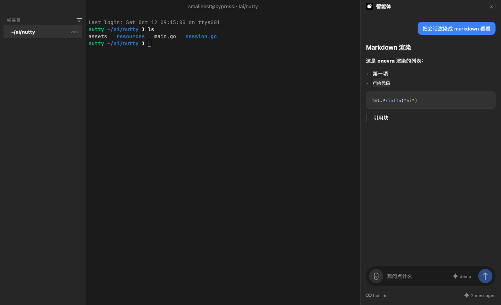

# Nutty 🌰

[English](README.md) | 简体中文

Nutty 是一款 macOS 原生终端应用，仿照 [otty.sh](https://otty.sh/) 而作。它用 Go 写成，建立在 [MyGo](https://github.com/egoist/mygo)、[uix](https://github.com/smallnest/uix) 组件和 [onevra](https://github.com/oneo-me/onevra) 的 markdown 渲染之上。

终端模拟器用的是 Ghostty 的，经 MyGo 的终端插件加载。界面由 MyGo 的原生工具包自绘，不用 webview。

## 截图



## 功能

- **标签页与分屏。** 每个标签页是一个会话，切走后照常运行。可向右或向下拆分，拖动分隔条，用 Cmd+] 和 Cmd+[ 在分屏间移动焦点。
- **会话侧边栏。** 每个会话占一个紧凑的标签，显示目录和 shell，悬停时出现关闭按钮。
- **信息面板。** ⓘ 按钮打开右侧面板，内容与 otty 的一致：工作目录及其操作（拷贝路径、在访达中显示、在 Zed 中打开）、运行中的进程、占用的端口。
- **命令面板。** Cmd+K 打开。可执行窗口操作、跳到某个会话、挑选终端主题。
- **Ghostty 主题。** 命令面板提供 25 个主题，也可选“跟随系统”，随窗口的浅色或深色外观切换。
- **智能体对话。** 右侧面板把对话渲染成 markdown。内置的智能体只是演示，接入真实模型的接口定义在 `agent.go`。
- **键盘优先。** 标签页、分屏、命令面板、字号、侧边栏和对话都能用键盘操作，快捷键列在菜单里。

## 运行

```sh
go run ./cmd/nutty
```

需要 Go 1.27，本机没有时它会自行下载。首次运行会把 `libghostty-vt`（Ghostty 的模拟器）下载到 MyGo 的缓存里。

## 打包

```sh
go run github.com/egoist/mygo/cmd/mygo@v0.4.8 build
```

产物是对应本机架构的 `Nutty.app` 和一个 DMG，在 `dist/` 下。`make package` 则构建通用（universal）版本，放在 `out/` 下，与发布流程的构建相同。应用为 ad hoc 签名，未经公证。

## 测试

```sh
go test ./...
```

测试不开窗口，全部无头运行。要渲染窗口预览图做目视检查：

```sh
NUTTY_SNAPSHOT=1 go test -run TestSnapshot ./internal/app/
```

它会写出 `/tmp/nutty-preview.png`（带对话面板）、`/tmp/nutty-preview-info.png`（带信息面板）和 `/tmp/nutty-preview-none.png`（两个面板都不带），每张另有一份 `-dark` 版本。

## 目录结构

项目采用标准的 Go 布局：入口在 `cmd/`，应用在 `internal/app/`，它用到的 `settings/` 和 `i18n/` 包同在 `internal/` 下。

| 文件 | 作用 |
| --- | --- |
| `cmd/nutty/main.go` | 入口 |
| `internal/app/app.go` | 窗口状态与操作 |
| `internal/app/session.go` | 会话、分屏树、分屏焦点 |
| `internal/app/view.go` | 根视图布局 |
| `internal/app/topbar.go` | 顶栏：标题和图标按钮 |
| `internal/app/rail.go` | 会话侧边栏 |
| `internal/app/info.go` | 信息面板：目录、进程、端口 |
| `internal/app/tabbar.go` | 标签栏、重命名对话框、关闭确认 |
| `internal/app/palette.go` | 命令面板里的命令 |
| `internal/app/themes.go` | 窗口外观：跟随系统、浅色、深色 |
| `internal/settings/themes.go` | 窗口配色和终端主题列表 |
| `internal/app/menus.go` | 应用菜单 |
| `internal/app/chat.go` | 智能体对话面板 |
| `internal/app/agent.go` | `Agent` 接口和演示智能体 |
| `internal/app/nut.go` | 应用的坚果图标（`internal/app/assets/nutty.svg`） |

## 智能体后端

`internal/app/agent.go` 声明了 `Agent` 接口，对话面板从它流式读取回复。`demoAgent` 用一小页 markdown 作答，让界面上的流式光标、思考指示和 markdown 渲染能从头到尾跑通。要用真实模型，把 `demoAgent` 换成调用模型的实现，将模型输出的文本流式写入 channel。
